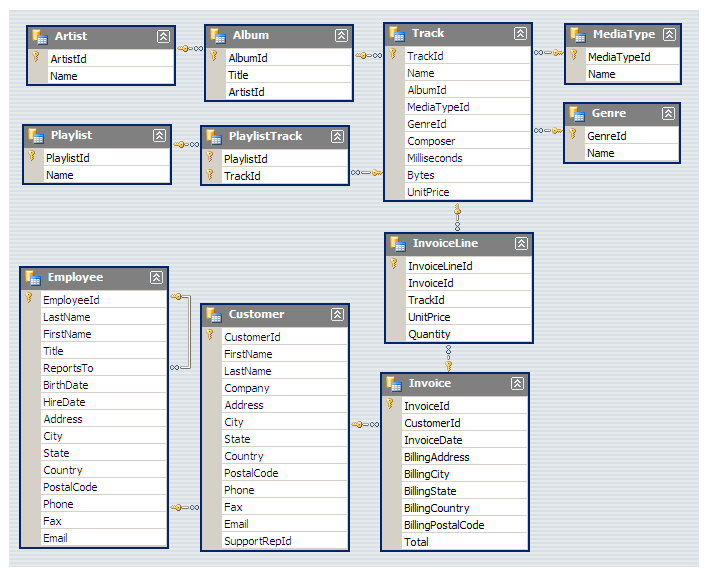

<div align="center">

# 🎵 Music Store SQL Analysis

SQL Server analysis of music purchases, customers, artists, tracks, and genres.


<p><b>Relational tables · Joins and aggregates · CTEs and window functions · Data checks</b></p>

</div>

---

## 📌 Project Overview

This project uses SQL Server to explore a sample music store's customers, invoices, invoice lines, tracks, albums, artists, and genres. Fifteen queries answer questions about sales by location, customer spending, popular music, and purchase prices. The project includes 11 CSV files and a relational schema diagram.

The supplied files credit Muhammad Ali Nawaz for project code and documentation. They do not establish the origin or license of the underlying sample dataset. The CSVs contain sample customer contact details; use them only in an appropriate local demonstration environment.

## 🎯 Objectives

- Create 11 SQL Server tables with keys, relationships, checks, and selected join indexes.
- Load the provided CSV records with a portable SQL script.
- Check table counts, trusted foreign keys, prices, quantities, and sales totals.
- Answer 15 business questions with readable joins, aggregates, subqueries, CTEs, and ranking functions.

## 🧱 Data Model



The model links artists to albums, albums to tracks, customers to invoices, and invoices to purchased tracks through invoice lines. Employees support customers, and playlists contain tracks through `playlist_track`. The SQL Server schema gives the playlist junction table a composite primary key, matching the supplied diagram. Foreign keys are added after loading the data and use SQL Server's default `NO ACTION` delete behavior.

The SQL Server load script uses the CSV values without changing the source CSVs; it maps `employee.birthdate` to `birth_date` and keeps the CSV name `invoice.billing_postal_code`. The original PostgreSQL backup and generated schema were removed from this SQL Server package.

## ✨ SQL Analysis

| Queries | Business question | Main SQL technique |
| --- | --- | --- |
| 1–5 | Employee seniority, invoice volume, leading cities and customers | `TOP`, grouping, joins |
| 6–8 | Rock customers and artists; long tracks | Multi-table joins, `DISTINCT`, subquery |
| 9 | Customer spending by artist | Line-price aggregation across five tables |
| 10–11 | Most purchased genre and highest spending customers by country | CTEs and `DENSE_RANK` to include ties |
| 12–15 | Popular artists, tracks, genres, and countries | Quantity totals and weighted unit prices |

Purchases are counted using `SUM(invoice_line.quantity)`. Average paid price by genre is line revenue divided by purchased units. Countries in query 10 are **customer countries**; query 11 uses **invoice billing countries**. Customers can have separate invoices billed to different countries.

## 📊 Supplied Data

| CSV | Rows | CSV | Rows |
| --- | ---: | --- | ---: |
| `artist.csv` | 275 | `album.csv` | 347 |
| `customer.csv` | 59 | `employee.csv` | 9 |
| `genre.csv` | 25 | `invoice.csv` | 614 |
| `invoice_line.csv` | 4,757 | `media_type.csv` | 5 |
| `playlist.csv` | 18 | `playlist_track.csv` | 8,715 |
| `track.csv` | 3,503 | | |

These are counts from the supplied CSVs, not results of a SQL Server run. Invoice dates in the CSV range from January 2017 to December 2020. The nine employee dates use day-month-year input and are written to `load_data.sql` in ISO format for SQL Server. Invoice totals match invoice-line totals when the source invoice values are rounded to the schema's two decimal places.

## 📁 Project Structure

```text
Music-Store-Analysis-SQL-Server/
├── create_database.sql       # Create MusicStoreSQL
├── create_tables.sql         # Tables, keys, and checks
├── load_data.sql             # Insert the unmodified CSV data into SQL Server
├── add_relationships.sql     # Foreign keys and join indexes
├── verify_data.sql           # Row counts and data checks
├── analysis.sql              # Fifteen business questions
├── dataset/                 # Eleven original CSV files
├── MusicDatabaseSchema.png  # Relational diagram
├── README.md
├── LICENSE
└── .gitignore
```

## ⚙️ Run in SQL Server

Open the scripts in SQL Server Management Studio and execute each file as a whole, in this order:

1. `create_database.sql`
2. `create_tables.sql` on a fresh database
3. `load_data.sql` once; it inserts all supplied CSV records in a transaction
4. `add_relationships.sql` once; it validates the loaded relationships while creating foreign keys
5. `verify_data.sql`; check that row counts pass, all 11 foreign keys are trusted, and the totals match
6. `analysis.sql`; execute individual numbered queries or the full file

The SQL files use SQL Server syntax and contain no `GO` batch separators. `load_data.sql` is a data script, so it is long; the analysis queries remain in the separate, short `analysis.sql`. Use a fresh `MusicStoreSQL` database for a complete rerun. Existing tables are not migrated, and the load script stops if the artist table already contains rows.

**SQL Server execution has not been verified here.** All 15 question bodies were checked against the supplied CSVs in SQLite after translating SQL Server-specific syntax. That test does not validate SQL Server execution. The archive contains no SQL Server results, query plans, performance benchmarks, stored procedures, or access-control scripts. Indexes are join aids, not evidence of measured speed improvements.

## 🧑‍💻 Project Credit

**Muhammad Ali Nawaz**  
SQL Developer / Database Developer

This credit appears in the supplied project documents. The CSV dataset's creator and license are not established by those documents, and this project does not claim authorship of the source data.

## 📄 License

The supplied project code and documentation are under the [MIT License](LICENSE). Check separate permissions before republishing the dataset or the diagram.
